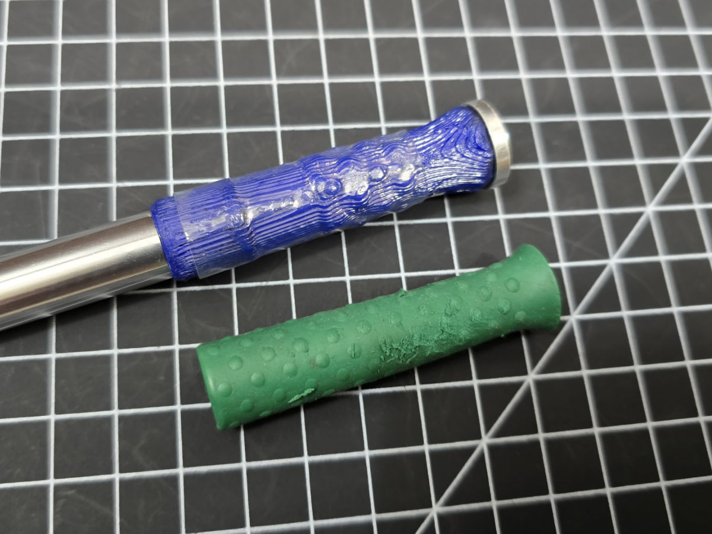

The rubber grip on my MX-H1-AV (the Metcal aluminum handpiece) wore out so I 3D printed replacements, because the official replacement costs like $30.

It is printed as two pieces, apply some hot glue to sandwich the aluminum stem, and then heat-shrink it.

