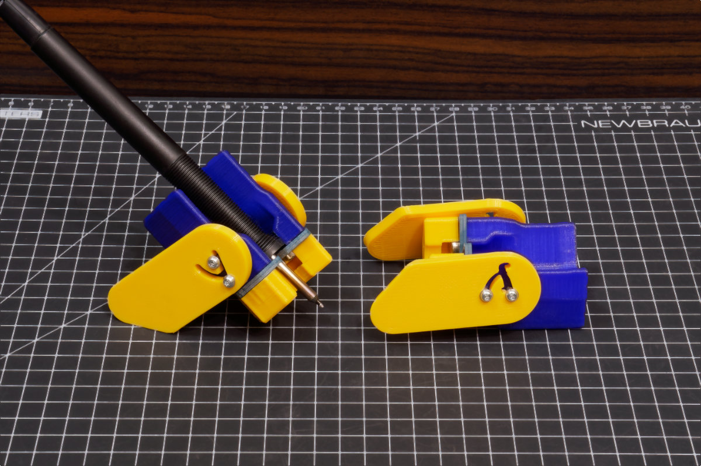

this directory contains the 3D printed and milled/cut components used for the folding soldering iron stand

see [this document to see the instructions](../../doc/build-guide-iron-stand.md)

This design is also meant to be a template. You can totally forget about the folding legs and incorporate the holder portion into a bigger permanent desktop stand.
