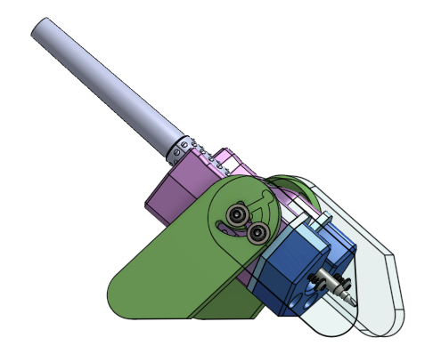
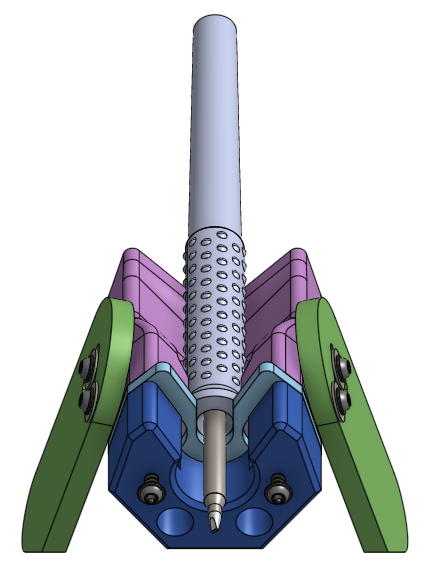

this directory contains the 3D printed and milled/cut components used for the folding soldering iron stand

see [this document to see the instructions](../../doc/build-guide-iron-stand.md)

The handle rest is available as `handle-rest-16mm.step` / `.stl` and
`handle-rest-18mm.step` / `.stl`. All other exported parts use the 16mm configuration.

Run `tools\onshape_step_export_sync.bat` from the repository to refresh the exports.
It downloads the stand twice, selecting the Onshape options named `16mm` and `18mm`.
`--skip-download` reuses the separate `stand-16mm.step` and `stand-18mm.step` files
under `mechanical/temp_downloads`; both must already exist.

